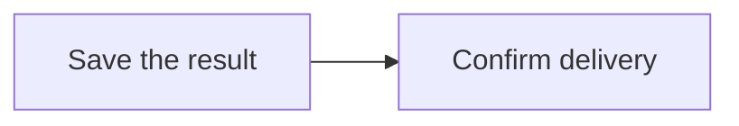

# Diagrams in artifacts

Artifacts render fenced `mermaid` blocks as diagrams in the reader and editor
preview. For example:

````markdown

````

Diagrams retain their natural size in a scrollable panel. **Expand diagram** opens
a larger viewer at 100% so labels stay readable. Scroll to explore or choose **Fit** for the whole chart. Escape closes the viewer and returns
focus to the Expand button. **Mermaid source** reveals the original text; malformed
diagrams show it automatically. Editing and Markdown export preserve that source.

The renderer is bundled locally, loaded only for documents containing Mermaid,
and renders diagrams as they approach the viewport. It uses strict security mode,
SVG text labels, and bounded source/edge counts. Diagram styles follow the system
light/dark appearance. It does not load a CDN or enable diagram links/callbacks.

To verify the native web UI, build the CLI with `cargo build --locked -p hey-boss --bin hey-boss`.
Run `cargo test --locked -p hey-boss --example web-fixture diagrams_keep_readable -- --ignored` to verify the reader and editor in Chrome.
For an interactive viewer, run `cargo run --locked -p hey-boss --example web-fixture -- artifact-diagrams` and open the printed URL. Stop it with Ctrl+C to remove the private fixture.
