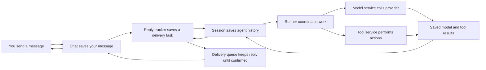
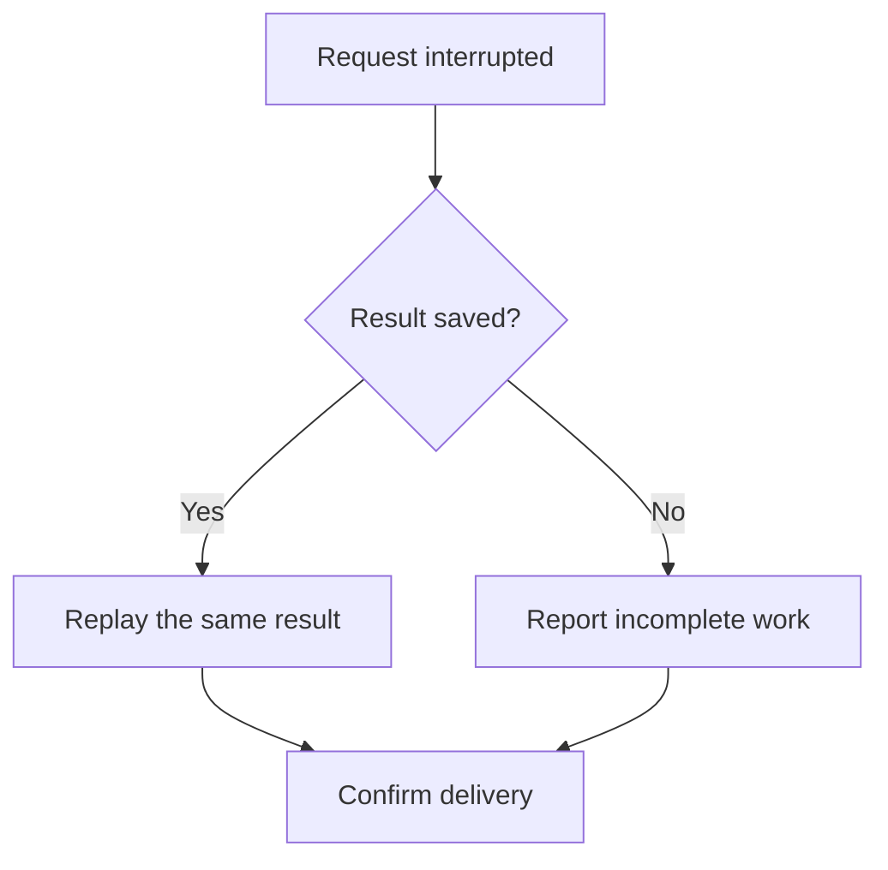
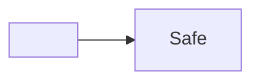

# Recovery flow

Follow the saved request through each service. Expand the diagram to see the full route.



## Recovery decision



## Broken source stays available

```mermaid
flowchart LR
 A[Broken
```

## Ordinary code

```js
const saved = true;
```

## Untrusted labels

